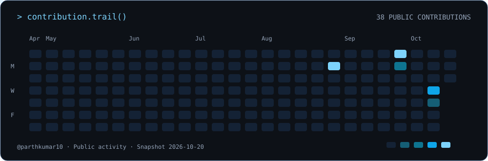

<!-- Proudly created with GPRM ( https://gprm.itsvg.in ) -->

# 💫 Hi 👋, I'm Parth Kumar
**A B.Tech Computer Science student from India exploring Software Engineering & Backend Development**

I enjoy logical problem-solving, exploring new tools, and understanding how applications work behind the scenes. I'm building my foundations in Java and developing the skills to turn ideas into useful software.

- 🌱 **I’m currently learning:** Core Java and programming fundamentals
- 🧩 **My next learning goal:** Data Structures & Algorithms
- 🔍 **I’m interested in:** Backend development, APIs, and practical software development
- 👯 **I’d like to connect with:** Fellow students, college seniors, and engineers to exchange ideas and learn together
- ⚡ **How I learn:** Experimenting with tools, trying out ideas, and exploring the concepts behind them

## 🌐 Connect with Me

## 🐍 My Contribution Trail

*GitHub activity snapshot; last refresh date is shown in the image. The snake is decorative.*

## 💻 Learning Focus

## ⚡ Parth's Debug Loop

## 📊 GitHub Stats
*Generated from @parthkumar10's GitHub activity. Cards refresh through third-party services and may be cached.*

*Language statistics reflect repository code, including AI-assisted experiments, rather than proficiency.*

### ✍️ Random Dev Quote

---

